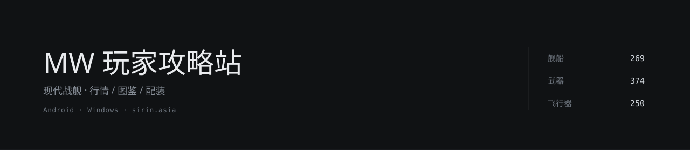

现代战舰（Modern Warships）的行情、图鉴与配装工具。Android 与 Windows 客户端，数据与站点同源。

网页版：[sirin.asia](https://sirin.asia)

## 下载

| 平台 | 版本 | 大小 | 安装包 |
|:---|:---|--:|:---|
| Android 8.0+ | `0.5.0` | 164 MB | [mwguide-0.5.0.apk](https://github.com/Sirin12315/mwyes/releases/download/v0.5.0/mwguide-0.5.0.apk) |
| Windows 10+ | `0.3.0` | 129 MB | [mwguide-pc-0.3.0-setup.exe](https://github.com/Sirin12315/mwyes/releases/download/pc-0.3.0/mwguide-pc-0.3.0-setup.exe) |

## 功能

- **行情**：市场船、通行证、赠礼与装备的价格聚合，可按条件筛选
- **图鉴**：舰船、战机、直升机、无人机与武器的完整属性，基础值与满级值同屏
- **对比**：多单位并排，属性、单轮伤害与评分收在一张表里
- **配装**：专精加点，改一个点就能看到属性怎么跟着变

## 安装

Android 下载后直接安装。覆盖安装保留数据；提示「已安装更高版本」时先卸载旧版。

Windows 运行安装包，按向导完成。

## 更新

每个版本单独一个 Release，文件名里的版本号与客户端内一致，改动写在对应 Release 说明里。

常见问题

**下载很慢或中断**

GitHub 的下载走海外节点，网络不稳时重试，或换成 Wi-Fi / 移动网络。

**提示「解析包错误」**

多半是下载不完整，重新下载一次，核对大小与上表一致。

**装完提示「已安装更高版本」**

先卸载旧版再装，数据在云端不会丢。

**旧版本还能用吗**

能用，但新功能只在最新版。

---

非官方工具，与游戏开发商及发行商无关
